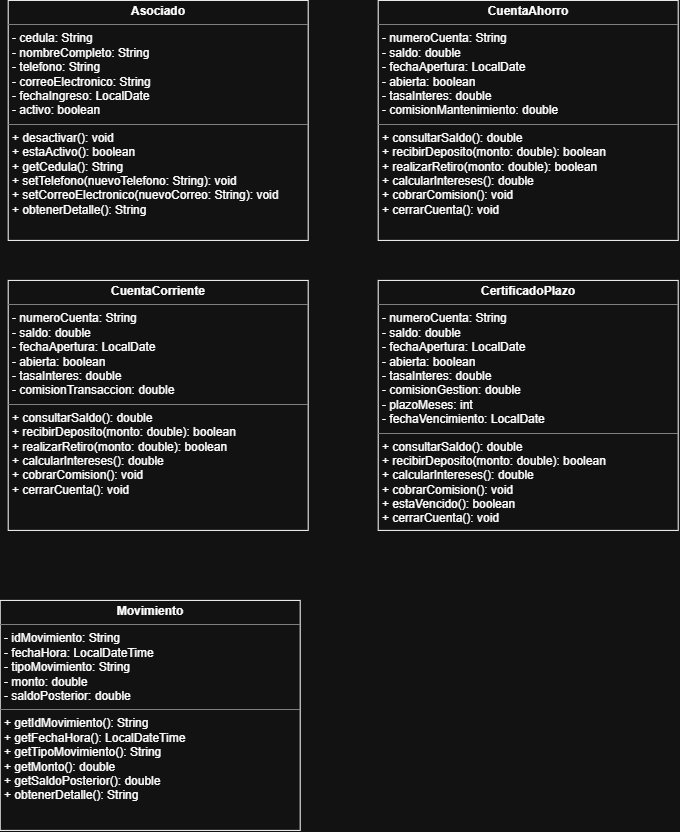

# Programacion

# Tarea 1: Modelado del Dominio - CoopeTica R.L.
Integrante 1: Camila Valeria Cabrera Arce- Usuario de GitHub: camilavaleriaarce
Integrante 2: Fabiola Velandia Badilla - Usuario de GitHub: Fabii202

# 1. Descripción breve
CoopeTica R.L. es una cooperativa de ahorro y crédito costarricense de tamaño mediano que busca automatizar y ordenar la información de sus asociados, cuentas y movimientos financieros mediante un sistema orientado a objetos. El dominio modelado contempla la gestión de los asociados (con su información personal y estado activo/inactivo), la administración de múltiples tipos de cuentas (cuenta de ahorro, cuenta corriente y certificados a plazo con reglas de negocio específicas), y el registro detallado de cada movimiento realizado (depósitos, retiros, aplicación de intereses y cobros de comisiones). Asimismo, el sistema permite realizar consultas de saldos, validaciones de fondos suficientes para retiros, cálculos de intereses por período y la generación de reportes de movimientos entre fechas.

# 2. Diagrama de clases del dominio

A continuación, presentamos el modelo de clases UML.

# 3. Justificación del modelo

Clases Seleccionadas y Diseño:
 **Asociado**: Se seleccionó para centralizar la información personal y el estado de cada cliente de la cooperativa (cedula, nombreCompleto, telefono, correoElectronico, fechaIngreso, activo), incorporando métodos clave como desactivar() para cumplir con la necesidad de desactivar sin borrar información histórica, además de métodos de consulta y modificación de datos de contacto.

 **CuentaAhorro, CuentaCorriente y CertificadoPlazo**: Se modelaron de forma específica para cubrir los tres productos que maneja la cooperativa. Cada una cuenta con atributos propios como tasas de interés, comisiones de mantenimiento o transacción, y en el caso del CertificadoPlazo, atributos de control temporal como plazoMeses y fechaVencimiento, junto con el método estavencido() que restringe retiros prematuros.

 **Movimiento**: Se incluyó para llevar un registro auditable de cada transacción realizada sobre las cuentas (idMovimiento, fechaHora, tipoMovimiento, monto, saldoPosterior), facilitando la generación de reportes y consultas detalladas.

# 4. Bitácora de uso de Inteligencia Artificial

A continuación, se detalla el uso de herramientas de Inteligencia Artificial para el desarrollo de esta tarea:
Primero, usamos Claude para darnos una guía de la tarea porque no sabíamos muy bien como usar GitHub, entonces nos dio una guía rápida para entender cómo estructurar bien el repositorio. Después utilizamos Gemini, para aclarar ideas sobre cómo modelar las clases del caso de CoopeTica y para que nos ayudara a ordenar y redactar este archivo README. Y en conclusión, todo lo que está en el diagrama y las decisiones finales las conversamos y armamos nosotras dos en pareja, asegurándonos de entender bien lo que estábamos entregando.

